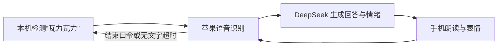

# 桌面小宠

把闲置 iPhone 放到固定支架上，变成一只会看你、会回应触摸、能语音聊天的桌面小宠。

当前版本 **0.5.4**。已经在 **iPhone XR / iOS 18.7.9** 上验证基础交互、本地唤醒与连续语音对话。仍是个人原型，尚未上架 App Store，也没有完成远距离唤醒、噪声和长时间运行的全面测试。

## 能做什么

- **看见你**：前置摄像头在本机检测人脸位置，驱动大眼睛跟随；支持诊断预览和人脸框。
- **回应触摸**：轻点、慢慢抚摸、长按安抚和连续戳有不同反应；有人回来时欢迎，无人时发呆、打瞌睡。
- **感知运动**：利用加速度和重力信息回应拿起、倾斜、放稳，配合轻触觉与本地电子叫声。
- **语音陪伴**：叫“瓦力瓦力”，听到“我在，你说”后提问；回答完自动接着听，不必每句话点按钮。
- **安静陪伴**：说“不聊了”“别说了”等结束口令，或约 8 秒没有识别文字，回到待唤醒。
- **可配置**：中文音色、语音服务地址和模型、本地唤醒、苹果联网识别、静音及运动感知均可设置。

固定支架不会转动手机；这里的“跟随”是屏幕眼神变化。人脸检测不识别身份，运动感知也不能准确判断手机是否真的被抱起。

## 先把它装到手机上

你需要一台可运行 Xcode 的 Mac、一台 iOS 18 或更新系统的 iPhone，以及能传数据的连接线。工程用 **Xcode 27.1** 验证；当前工程格式需要支持该格式的 Xcode，较旧版本未验证。

1. 克隆仓库并打开 `DeskPet.xcodeproj`。
2. 在 Xcode 登录自己的 Apple 账户；在 `Signing & Capabilities` 选择自己的 Team，把 `com.example.deskpet` 改成自己的唯一 Bundle Identifier。
3. 连接、解锁 iPhone，完成“信任此电脑”，开启开发者模式，然后选择这台真机运行。
4. 如果手机要求信任开发者，到“设置 → 通用 → VPN 与设备管理”完成信任。
5. 首次打开允许相机、麦克风和语音识别；如果授权打断了首次启动，再点一次麦克风。
6. 手机右上角“…”→“AI 与 API Key 设置”，填写自己的 DeepSeek Key。默认地址为 `https://api.deepseek.com`，模型为 `deepseek-flash`。

**完整步骤、常见报错、命令行安装和换机清单： [iPhone 安装与换机指南](docs/iphone-setup.md)。** 不需要下载 iOS 模拟器才能装到真机；手机运行后不需要 Mac 一直在线。

## 使用方式

手机横放，按屏幕文字正向摆放，保持 App 在前台。先到“…”→“打开诊断”，确认预览正立、人脸框贴住脸；不同机型的镜头方向尚需验证。

叫“瓦力瓦力”，等它说“我在，你说”后再说内容。回答完等界面显示“我在听”再接着说。当前没有唤醒前预录缓冲，唤醒词后立刻连说可能丢失开头。右下角麦克风是备用入口；聆听时再点可手动发送。回答时点宠物可以停播并重新聆听。

本地唤醒开关默认开启；首次使用需先设置 Key 和授予权限。切后台或锁屏会停止采集，回前台后按开关与权限恢复待唤醒。

## 语音是怎么工作的



唤醒使用 **sherpa-onnx 的中文关键词模型**，不是 Apple 的唤醒模型，也没有使用 Porcupine。约 12.5 MiB 的模型已经包含在仓库中，无需额外唤醒服务账户。待唤醒时只在手机内检测关键词，不持续全文转写或调用 AI。

当前只保留唤醒词“瓦力瓦力”。使用较新的中英 KWS 浮点模型，并只在唤醒输入上做最高 16 倍、带峰值保护的增益补偿；这不改变关键词触发阈值，也不会给整句识别或朗读加音量。

整句识别优先使用苹果本机能力；如果不可用，只有在你允许“苹果联网语音识别”后才回退到联网识别。待机用较少音频处理的收音模式；唤醒后切换到通话音频处理进行朗读与对话。

## 数据与费用

| 数据或功能 | 处理位置与说明 |
| --- | --- |
| 前摄画面、人脸位置 | 本机处理；不保存照片，不上传给 AI |
| 唤醒词检测 | 本机运行，无需订阅费或唤醒服务 Key |
| 语音识别 | 优先本机；允许联网后，苹果可能处理录音 |
| 对话文字 | 当前输入、最近对话和少量宠物状态发往配置的 HTTPS AI 服务 |
| API Key | 只存手机 Keychain，不放源码、配置文件或日志 |
| 对话历史 | 仅保留在当前进程内；重启后清除，不属于长期记忆 |
| 诊断与导出 | 只记录统计、耗时、错误码等元数据；不记录聊天正文或原始音视频 |

DeepSeek 调用按其账户规则计费，本项目不提供公共 Key。个人免费签名可以用于真机测试，但会过期，需要重新构建签名；具体限制见 Apple 官方说明和安装指南。

## 已知限制

- 用户已反馈新词比之前更易唤醒；尚未取得完整真人命中次数统计，长期表现仍需观察。
- 唤醒对不同音色、距离和噪声仍可能漏检；不能等同于 Siri 的唤醒效果。
- XR 上曾出现苹果本机识别错误 201，即使听写开关已开；错误码本身不足以断言用户关闭了听写。
- “语音插话”仍是实验功能，尚未完成全双工验收；稳定路径是轮流说话。
- 暂不做主人声纹；没有云端长期记忆、工具执行或真实转头机构。
- AI JSON 模式可能返回空内容或无效格式；当前区分网络与格式错误，对空内容和中途断连最多重试一次。错误后按开关恢复本地待唤醒。
- 仅验证了 XR；其他机型、iOS 版本及连续运行时的功耗和发热需自行验收。

## 开发与验证

依赖由 Swift Package Manager 管理，提交了 `Package.resolved`，固定 sherpa-onnx 与 ONNX Runtime 版本。首次构建需要网络下载框架。

运行不依赖手机的逻辑和模拟网络故障测试：

```sh
./scripts/test.sh
```

无签名构建（只验证编译，不能直接安装）：

```sh
xcodebuild -project DeskPet.xcodeproj -scheme DeskPet \
  -configuration Debug -destination 'generic/platform=iOS' \
  -derivedDataPath .build-ios CODE_SIGNING_ALLOWED=NO build
```

人脸方向、实际唤醒、音频路由、触觉和发热必须在真机上验证；模拟网络测试不代表外网稳定性。

## 资料与许可

- [iPhone 安装与换机指南](docs/iphone-setup.md)
- [语音陪伴设计与演进](docs/voice-design.md)：含历史方案，以末尾更新和当前代码为准。
- [唤醒对比测试](docs/wake-benchmark.md)：包含漏检样本及测试边界。
- [真机验证与问题记录](docs/validation.md)：保留发现过的问题及验证边界，公开版本已移除个人标识。
- [第三方组件和模型来源](ThirdParty/来源.md)、[模型校验值](ThirdParty/models.sha256)

项目自行编写的代码按 [MIT 许可证](LICENSE) 开放；唤醒模型、sherpa-onnx 和 ONNX Runtime 分别遵循其上游许可证，见 `ThirdParty`。公开仓库不含签名证书、设备标识或任何可用凭据。
